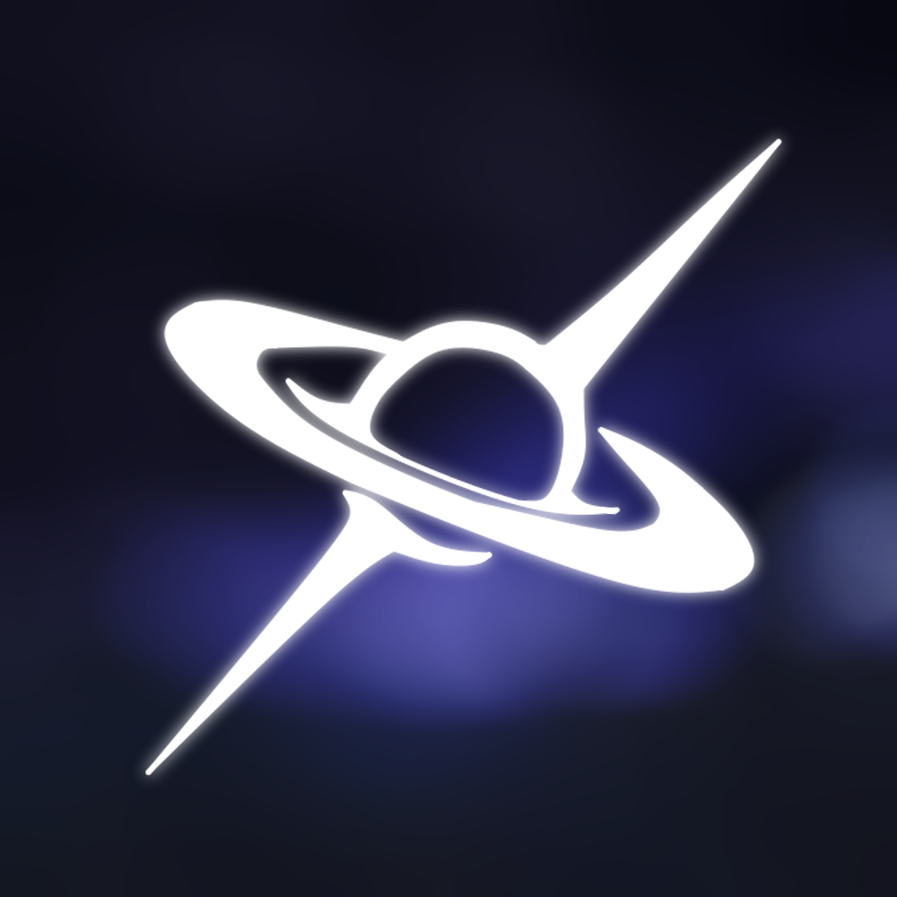

<div align="center">
  

  <h1>Pondus</h1>

  <p>
    <a href="https://modrinth.com/mod/pondus">
      
    </a>
    
    
    
    
  </p>

  <p>Lightweight, bloat-free 3D custom gravity API for Minecraft (NeoForge &amp; Fabric). Build custom gravity items, armor, spells, zones, zero-G space dimensions, and Outer Wilds-style planetary systems.</p>
</div>

## Documentation / Wiki
* [Wiki Home](docs/Home.md)
* [Getting Started (NeoForge &amp; Fabric)](docs/Getting-Started.md)
* [API Reference](docs/API-Reference.md)
* [Gravity Zones &amp; Visualizer](docs/Gravity-Zones.md)
* [Outer Wilds &amp; Planetary Gravity Guide](docs/Outer-Wilds-Guide.md)

## Features
- Full 3D gravity control (cardinal + continuous world-space vectors with smooth frame-rate-independent camera damping)
- Persistent per-dimension gravity zones (`box`, `sphere`, `cylinder`, `center` radial gravity, smooth transitions, and `G` wireframe visualizer)
- Outer Wilds-ready planetary physics: zero-G space dimensions + absolute-strength local fields, Newtonian `1/r²` helper, and multi-body Lagrange point blending
- Declarative addon API for custom items/armor/charms (`ItemGravityRule`), timed modifiers, dimension-scoped `GravitySource`s, and `GravityUpdateEvent`
- Pure API: zero gameplay bloat (no blocks or items added by Pondus itself)

## Gravity zones
Create and edit box, sphere, or cylinder zones. Position arguments use the same coordinate format and autocomplete as `/fill`:

```text
/gravity zone create <id> box <pos1> <pos2> <direction> <strength> <transition>
/gravity zone create <id> sphere <center> <radius> <direction> <strength> <transition>
/gravity zone create <id> cylinder <center> <axis> <radius> <height> <direction> <strength> <transition>
/gravity zone edit <id> <shape and arguments...>
/gravity zone enable <id>
/gravity zone disable <id>
/gravity zone remove <id>
/gravity zone status
```

For example: `/gravity zone create tower cylinder ~ ~ ~ y 6 24 up 1 3`. The cylinder axis is `x`, `y`, or `z`; direction accepts the six cardinal directions or `center`. `center` defines a continuous gravity vector toward the geometric center of the box, sphere, or cylinder, with a smooth core fade and angular hysteresis so walking across sphere faces stays stable. Existing zone IDs autocomplete for `edit`, `enable`, `disable`, and `remove`. `transition` is the smooth falloff distance in blocks outside the core shape; use `0` for a hard boundary. The original `/gravity zone create <id> <pos1> <pos2> <direction> <strength>` box syntax remains available with a default transition of 1.8 blocks.

Zones are saved per dimension with the world and persist across restarts and chunk reloads.
Overlapping zones normalize and blend their gravity vectors smoothly with the entity's base gravity. Press `G` to toggle the client-side gravity-zone visualizer (the key can be rebound in Controls). It draws each zone's core and transition boundary plus direction arrows for the current dimension.

## Addon API
Pondus is designed as a library that other mods can depend on to build custom gravity items, armor, blocks, machines, spells, and dimensions. Everything is accessible through `PondusAPI`:

### 1. Custom Items, Armor & Inventory Charms (`ItemGravityRule`)
Bind any custom `Item` (or `Predicate<ItemStack>` for tags/DataComponents) to a gravity effect during mod setup. Pondus handles evaluation, priority stacking, and server-to-client sync automatically:

```java
import dinner.dev.pondus.api.GravityField;
import dinner.dev.pondus.api.GravityModifier;
import dinner.dev.pondus.api.ItemGravityRule;
import dinner.dev.pondus.api.PondusAPI;
import net.minecraft.core.Direction;
import net.minecraft.world.entity.EquipmentSlot;

// Moon Boots: 0.25x gravity while worn on feet (strength-only: never overrides direction!)
PondusAPI.registerItemGravity(
    ModItems.MOON_BOOTS.get(),
    ItemGravityRule.wornIn(EquipmentSlot.FEET)
        .strength(0.25)
        .build()
);

// Gravity Anchor: locks gravity DOWN while held in either hand (ITEM_PRIORITY = 75 beats zones)
PondusAPI.registerItemGravity(
    ModItems.GRAVITY_ANCHOR.get(),
    ItemGravityRule.heldInEitherHand()
        .direction(Direction.DOWN)
        .priority(GravityModifier.ITEM_PRIORITY)
        .build()
);

// Dynamic Gravity Staff: inspects DataComponents, sneaking, or entity look direction each tick
PondusAPI.registerItemGravity(
    ModItems.GRAVITY_STAFF.get(),
    ItemGravityRule.heldInMainHand()
        .dynamic((entity, stack) -> {
            if (!entity.isShiftKeyDown()) {
                return null; // inactive unless sneaking
            }
            Direction targetDir = Direction.getNearest(
                entity.getLookAngle().x, entity.getLookAngle().y, entity.getLookAngle().z
            );
            return GravityField.ofDirection(targetDir, 1.0, GravityModifier.ITEM_PRIORITY);
        })
        .build()
);
```

### 2. Timed Gravity Abilities (Wands, Consumables, Projectiles)
Apply temporary gravity changes that automatically tick down on the server, persist in NBT, and clean up + sync on expiration:

```java
// Flip a target entity's gravity UP for 5 seconds (100 ticks) on item right-click / hit:
PondusAPI.applyTimedGravity(
    target,
    "mymod:gravity_wand",
    Direction.UP,
    1.0,
    GravityModifier.ITEM_PRIORITY,
    100
);

// Give a player 0.3x low-gravity for 15 seconds (300 ticks) without changing direction:
PondusAPI.applyTimedGravityStrength(player, "mymod:feather_elixir", 0.3, 300);
```

### 3. Direct Entity Control, Events & Coordinate Helpers

```java
import dinner.dev.pondus.api.PondusAPI;
import dinner.dev.pondus.api.IEntityGravityData;
import net.minecraft.core.Direction;
import net.minecraft.world.entity.Entity;
import net.minecraft.world.phys.Vec3;

// Get gravity data for an entity
IEntityGravityData gravity = PondusAPI.getGravityData(entity);

// Set base gravity direction & strength
PondusAPI.setBaseGravityDirection(entity, Direction.UP);
PondusAPI.setBaseGravityStrength(entity, 1.5);
PondusAPI.resetGravity(entity);

// Convert vectors or directions between world space and entity gravity-local space
Vec3 worldForward = PondusAPI.localToWorld(entity, new Vec3(0, 0, 1));
Direction localUpInWorld = PondusAPI.localToWorld(entity, Direction.UP);

// Listen for gravity changes (fired whenever direction, vector, or strength changes)
@net.neoforged.bus.api.SubscribeEvent
public static void onGravityChange(dinner.dev.pondus.api.GravityUpdateEvent event) {
    Entity entity = event.getEntity();
    IEntityGravityData data = event.getGravity();
}
```

### 4. Programmatic Persistent Zones
Create, toggle, or remove persistent per-dimension gravity zones directly from code:

```java
import dinner.dev.pondus.api.PondusAPI;
import dinner.dev.pondus.zone.Zone;

Zone planet = Zone.sphere("mymod:planet_core", blockPos, 16.0, Direction.DOWN, true, 1.0, 4.0);
PondusAPI.addZone(serverLevel, planet);
PondusAPI.setZoneEnabled(serverLevel, "mymod:planet_core", false);
PondusAPI.removeZone(serverLevel, "mymod:planet_core");
```

### 5. Block-Backed & Custom `GravitySource`s

Pondus intentionally does not ship gravity blocks, items, or other gameplay content. For dynamic block entities or machines, register a dimension-scoped `GravitySource` with `PondusAPI.registerLevelGravitySource(serverLevel, source)` — it is evaluated only in that dimension and automatically cleared when the server stops (so it never leaks across worlds):

```java
import dinner.dev.pondus.api.GravityField;
import dinner.dev.pondus.api.GravityFieldShapes;
import dinner.dev.pondus.api.GravityModifier;
import dinner.dev.pondus.api.GravitySource;
import dinner.dev.pondus.api.PondusAPI;
import net.minecraft.core.BlockPos;
import net.minecraft.core.Direction;
import net.minecraft.resources.ResourceLocation;
import net.minecraft.server.level.ServerLevel;
import net.minecraft.world.entity.Entity;
import net.minecraft.world.phys.Vec3;

public final class UpdraftSource implements GravitySource {
    private final ResourceLocation id;
    private final BlockPos anchor;

    public UpdraftSource(ResourceLocation id, BlockPos anchor) {
        this.id = id;
        this.anchor = anchor;
    }

    @Override
    public ResourceLocation id() {
        return id;
    }

    @Override
    public GravityField getGravityField(Entity entity) {
        double influence = GravityFieldShapes.sphereInfluence(
            entity.getBoundingBox().getCenter(),
            Vec3.atCenterOf(anchor),
            6.0,
            2.0
        );
        if (influence == 0.0) {
            return null;
        }
        return GravityField.ofDirection(Direction.UP, influence, GravityModifier.ZONE_PRIORITY);
    }
}
```

Register when the block entity loads and unregister when removed:

```java
ResourceLocation sourceId = ResourceLocation.fromNamespaceAndPath(
    "examplemod",
    "updraft/" + anchor.getX() + "_" + anchor.getY() + "_" + anchor.getZ()
);
PondusAPI.registerLevelGravitySource(serverLevel, new UpdraftSource(sourceId, anchor));

// Later, when the block entity is removed:
PondusAPI.unregisterLevelGravitySource(serverLevel.dimension(), sourceId);
```

`GravityFieldShapes` provides `boxInfluence`, `sphereInfluence`, `cylinderInfluence`, `centerVector`, `coreScale`, and `inverseSquareStrength`. Use `GravityField.strengthOnly(multiplier)` for fields that only scale gravity strength without changing direction, or `GravityField.planetary(vector, strength)` for Outer Wilds-style planets and moons in zero-G space dimensions (`PondusAPI.setDimensionGravityStrength(spaceLevel, 0.0)`):

```java
// Example: Newtonian planet / moon in a zero-G space dimension
public final class PlanetGravitySource implements GravitySource {
    private final ResourceLocation id;
    private final Supplier<Vec3> centerSupplier; // supports orbiting/moving planets
    private final double surfaceRadius, surfaceGravity, maxRange;

    @Override
    public GravityField getGravityField(Entity entity) {
        Vec3 pos = entity.getBoundingBox().getCenter();
        Vec3 center = centerSupplier.get();
        double dist = pos.distanceTo(center);
        double strength = GravityFieldShapes.inverseSquareStrength(dist, surfaceRadius, surfaceGravity, maxRange);
        if (strength <= 1.0E-4) {
            return null;
        }
        Vec3 dir = GravityFieldShapes.centerVector(pos, center, 0.35);
        return dir.lengthSqr() < 1.0E-8 ? null : GravityField.planetary(dir, strength);
    }
}
```

Multiple planetary sources registered at the same priority automatically combine vectorially (forming natural Lagrange points between planets and moons), while absolute-strength fields work even when ambient dimension gravity is `0.0`.

## Installation Guide

add the Modrinth maven repository to your `build.gradle`:
```gradle
repositories {
    maven {
        url = "https://api.modrinth.com/maven"
        content {
            includeGroup("maven.modrinth")
        }
    }
}
```
Add Pondus to the dependencies section of `build.gradle`:
```gradle
dependencies {
    // NeoForge:
    implementation("maven.modrinth:pondus:${project.pondus_version}")
    // Fabric (Loom):
    // modImplementation("maven.modrinth:pondus:${project.pondus_version}")
}
```
Last, set the Pondus version you want in `gradle.properties`:
```properties
pondus_version=1.1.0
```

## Requirements
- Minecraft 1.21.1
- NeoForge 21.1+ (`master` branch) or Fabric Loader 0.16+ + Fabric API (`fabric-port` branch)
- Cloth Config 15.0.140+

## License
This mod is licensed under the MIT License.
